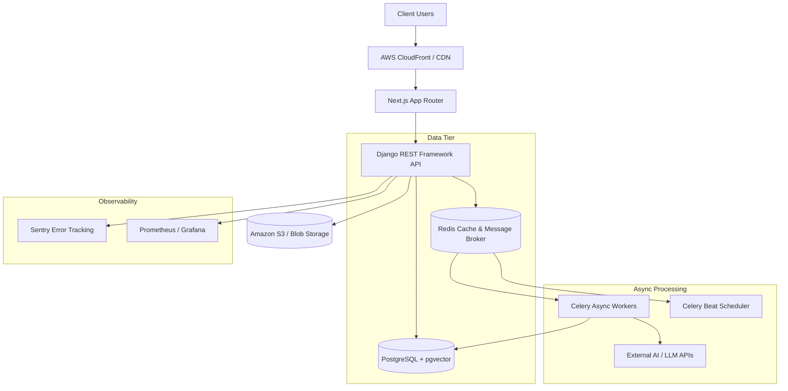
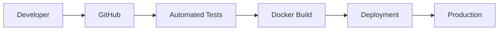
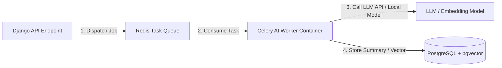

# Deployment Document

Version: 1.0

---

# Table of Contents

1. Deployment Goal
2. Environment Strategy
3. Infrastructure Architecture
4. Local Development Setup
5. Docker Architecture
6. Cloud Deployment
7. CI/CD Pipeline
8. Database Deployment
9. AI Service Deployment
10. Monitoring
11. Security
12. Backup Strategy
13. Scaling Strategy

---

# 1. Deployment Goal

Create a reliable deployment system that supports:

- Fast development
- Secure production
- Easy scaling
- Continuous improvement

The deployment strategy should support the evolution from MVP to enterprise platform.

---

# 2. Environment Strategy

The project uses three environments:

## Development

Purpose:

Daily coding and testing.

Example:

```
Developer Laptop

Docker

Local Database
```

---

## Staging

Purpose:

Pre-production testing.

Used for:

- Feature testing
- QA testing
- Client demos

---

## Production

Purpose:

Real users.

Requirements:

- High availability
- Monitoring
- Security

---

# 3. Infrastructure Architecture

Production architecture:

# 3. Infrastructure Architecture

Production deployment topology:



---

# 4. Local Development Setup

Required tools:

```
Git

Docker

Python

Node.js

PostgreSQL

VS Code
```

---

# Local Services

Using Docker:

```
docker-compose.yml
```

Services:

```
frontend

backend

database

redis

ai-engine
```

---

# 5. Docker Architecture

Example:

```
project-root/
├── docker-compose.yml
├── docker-compose.prod.yml
├── backend/
│   ├── Dockerfile
│   └── ...
├── frontend/
│   ├── Dockerfile
│   └── ...
└── ai-engine/
    ├── Dockerfile
    └── ...

```

---

# Docker Benefits

Provides:

- Same environment for all developers
- Easy deployment
- Isolation
- Scalability

---

# 6. Cloud Deployment

Recommended:

## Initial MVP

Cloud:

- AWS
- Google Cloud
- Azure

Recommended AWS:

```
Frontend:

AWS Amplify / CloudFront


Backend:

AWS ECS


Database:

Amazon RDS PostgreSQL


Storage:

Amazon S3


Cache:

ElastiCache Redis
```

---

# Future Enterprise

Architecture:

```
Kubernetes

+

Containers

+

Load Balancer

+

Auto Scaling
```

---

# 7. CI/CD Pipeline

Purpose:

Automatically test and deploy code.

Workflow:



---

# Pipeline Steps

## Step 1

Developer creates code.

---

## Step 2

Push to GitHub.

---

## Step 3

CI runs:

- Unit tests
- Security checks
- Code quality checks

---

## Step 4

Build Docker images.

---

## Step 5

Deploy automatically.

---

# 8. Database Deployment

Production database:

## Technology

- **Engine:** Managed PostgreSQL (Amazon RDS / Cloud SQL) with `pgvector` extension enabled.
- **Indexing:** HNSW cosine similarity vector index (`vector(1536)`) for semantic search.

Requirements:

- Automated backups
- Encryption
- Monitoring

---

## Migration & Zero-Downtime Deployment

- Django database migrations (`python manage.py migrate`) run as a pre-deployment step during CI/CD.
- Multi-Tenant FK constraints (`organization_id`) verified during deployment checks.
- Daily automated snapshot backups with Point-In-Time Recovery (PITR) enabled.

# Database Migration

Process:

```
Developer
↓
Migration File
↓
Testing
↓
Production Database
```

---

# 9. AI Service Deployment

AI service runs separately.

## Architecture & Execution Model:

The AI layer operates on an **asynchronous job processing architecture** to isolate heavy LLM inference tasks from client-facing REST endpoints:

1. **Job Dispatch:** Django API Endpoint dispatches background task to **Redis Task Queue**.
2. **Task Consumption:** **Celery AI Worker Container** consumes task from Redis.
3. **Model Execution:** Celery Worker invokes external API or local LLM pipeline using prompt templates from `ai-engine/prompts/`.
4. **Data Persistence:** Results and vector embeddings (`vector(1536)`) are stored in **PostgreSQL + pgvector**.



---

### Deployment Infrastructure

- **Phase 1 (MVP):** Decoupled prompt management (`ai-engine/prompts/`) executing via Celery background workers; external LLM APIs (OpenAI, Claude, or Hugging Face hosted models).
- **Phase 2+ (Scale):** GPU-enabled container instances (AWS ECS GPU / EKS) for local LLM inference and embedding generation pipelines.

---

# 10. Monitoring

Monitor:

## Application

- API response time
- Errors
- Requests

---

## Database

- Query performance
- Connections
- Storage

---

## AI

- Model accuracy
- Response quality
- Token usage

---

# Monitoring Tools

Examples:

Application:

- Prometheus
- Grafana

Errors:

- Sentry

Cloud:

- AWS CloudWatch

---

# 11. Security

## Multi-Tenant Data Isolation

- Enforce mandatory `organization_id` scoping across all DB queries and API selectors.
- Strict authorization policy checks (`IsOrganizationOwner`, `IsAdminUser`) on sensitive organizational routes.

## API & Authentication Security

- **JWT Token Management:** Short-lived access tokens (15 minutes) with rotating refresh tokens stored in HTTP-only cookies.
- **Rate Limiting:** Redis-backed rate-limiting throttles on public search (`100/min`) and auth/LLM endpoints (`10/min`).
- **Input Validation:** DRF serializers enforce strict payload schemas to prevent injection attacks.

## Database & Secret Protection

- DB storage encrypted at rest (AES-256) and in transit (TLS 1.3).
- Environment secrets injected securely at runtime via AWS Secrets Manager / Doppler.

---

# 12. Backup Strategy

Backup:

## Database

Daily automated backup.

---

## Files

Backup:

- Images
- Documents
- Business files

---

## Disaster Recovery

Maintain:

- Backup copies
- Recovery process
- Recovery testing

---

# 13. Scaling Strategy

## Stage 1: MVP

Architecture:

```
Single cloud deployment

+

Managed database
```

---

## Stage 2: Growth

Add:

```
Load Balancer

Multiple backend instances

Caching

Search engine
```

---

## Stage 3: Enterprise

Move to:

```
Kubernetes

Microservices

Distributed databases

Advanced AI infrastructure
```

---

# Final Deployment Strategy

Start simple:

```
Docker

+

Cloud Platform

+

Managed Database

+

CI/CD
```

Scale when needed:

```
Containers

+

Kubernetes

+

Distributed Architecture
```

---

End of Document
