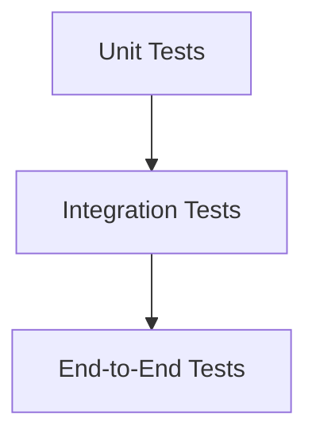
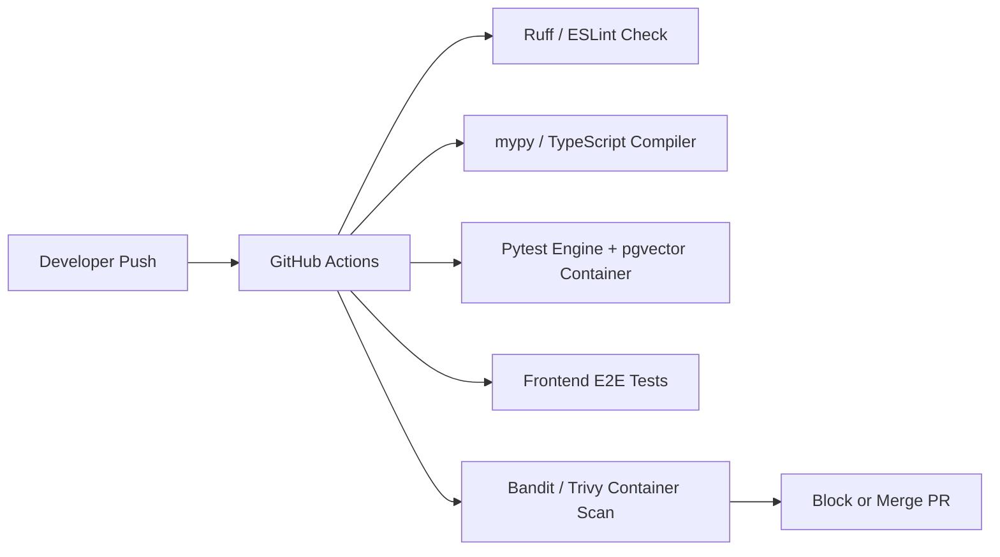

# Testing Strategy Document

Version: 1.0

---

# Table of Contents

1. Testing Goal
2. Testing Principles
3. Testing Levels
4. Backend Testing
5. Frontend Testing
6. API Testing
7. Database Testing
8. AI Testing
9. Security Testing
10. Performance Testing
11. Automated Testing Pipeline
12. Release Checklist

---

# 1. Testing Goal

The purpose of testing is to ensure the platform is:

- Reliable
- Secure
- Scalable
- Easy to maintain
- Providing accurate AI results

Testing must happen throughout development, not only before launch.

---

# 2. Testing Principles

## Test Early

Find problems before production.

---

## Automate Repetitive Testing

Automated tests should run on every code change.

---

## Test Business Logic

The most important parts of the system must have strong coverage.

---

## Quality Over Quantity

A few meaningful tests are better than many weak tests.

---

# 3. Testing Levels

The testing pyramid:



---

# 4. Backend Testing

## Technology Stack

- **Framework:** `pytest`, `pytest-django`, `pytest-cov`
- **Isolation:** Transactional DB fixtures with `factory_boy` test factories

## Service & Selector Layer Testing

Following the vertical slice pattern (`features/<feature_name>/services.py` & `selectors.py`):

- **Service Unit Tests:** Test isolated business mutations (e.g., `create_review()`, `verify_organization()`).
- **Selector Tests:** Verify read queries, pagination wrappers, and strict `organization_id` foreign-key filters.
- **Async Task Tests:** Mock Celery tasks (`@pytest.mark.celery`) to verify job dispatch for background LLM processing.

---

# Model Testing

Test:

- Database relationships
- Constraints
- Validation

Example:

```
Organization cannot exist without industry
```

---

# 5. Frontend Testing

Technology:

```
Jest

React Testing Library

Playwright
```

---

# Component Testing

Test:

- Buttons
- Forms
- Cards
- Search components

Example:

```
Login button submits correctly
```

---

# User Interface Testing

Verify:

- Pages load
- Forms work
- Navigation works

---

# 6. API Testing

Purpose:

Ensure backend communication works correctly.

Technology:

```
Postman

Pytest

OpenAPI Testing
```

---

# Test:

## Authentication API

Verify:

- User registration
- Login
- Token validation

---

## Organization API

Verify:

- Create organization
- Update profile
- Permission rules

---

## Review & Async AI API Testing

Verify endpoints adhering to the standard response wrapper:

- **POST `/api/v1/organizations/{id}/reviews/`:** Create review, trigger Celery worker, and validate schema.
- **POST `/api/v1/organizations/{id}/ai/review-summary/`:** Returns `202 Accepted` with `task_id`.
- **GET `/api/v1/ai/tasks/{task_id}/`:** Poll status (`PENDING` $\rightarrow$ `SUCCESS`) and assert JSON body contract.

---

# 7. Database Testing

Test:

## Data Integrity & Multi-Tenancy Isolation

- Verify foreign-key cascading rules and multi-tenant scoping (`organization_id`).
- Validate strict database constraints (e.g., unique constraints on user reviews per service).

## Vector Similarity (`pgvector`) Testing

- **HNSW Index Query Execution:** Test cosine distance queries (`<->` operator) on `vector(1536)` fields.
- **Embedding Ingestion Pipeline:** Verify that mock text embeddings populate and index without throwing dimensionality mismatches.
- **Query Latency:** Benchmark `pgvector` query execution against seeded dataset baseline.

---

## Performance

Test:

- Query speed
- Large datasets
- Index usage

---

# 8. AI Testing & Prompt Evaluation

AI outputs require specialized evaluation because LLM responses are probabilistic.

---

## Prompt & Pipeline Testing

- **Prompt Verification:** Unit test prompt templates in `ai-engine/prompts/` to prevent missing dynamic variables.
- **Deterministic Mocking:** Mock external LLM API calls (OpenAI/Claude) using `vcrpy` or `pytest-mock` to isolate API testing costs.

## Semantic Search & Recommendation Metrics

- **Vector Search Relevance:** Evaluated using Mean Reciprocal Rank (MRR) and Normalized Discounted Cumulative Gain (NDCG).
- **Sentiment Classification:** Measured using Precision, Recall, and F1 Score against labeled validation sets.

## Safety & Hallucination Guardrails

- **Grounding Validation:** Ensure AI review summaries strictly derive from ingested user reviews without hallucinating facts.
- **Structured Output Parsing:** Assert that LLM responses parse cleanly into JSON schemas via Pydantic validator models.

---

# AI Model Version Testing

Track:

```
Model Version

Input

Output

Performance
```

---

# 9. Security Testing

Purpose:

Protect users and businesses.

---

# Authentication Testing

Check:

- Password security
- Token expiration
- Unauthorized access

---

# Authorization Testing

Example:

Customer cannot access admin dashboard.

---

# Input Security

Test:

- SQL injection
- XSS attacks
- Invalid data

---

# API Security

Test:

- Rate limiting
- Permission checks
- Data exposure

---

# 10. Performance Testing

Purpose:

Ensure the system works under load.

---

# Load Testing

Test:

Example:

```
10,000 users searching at the same time
```

---

# Stress Testing

Find system limits.

Example:

Increase traffic until failure.

---

# Performance Metrics

Measure:

## Backend

- API response time
- Database queries

## Frontend

- Page loading speed

## AI

- Response time
- Processing cost

---

# 11. Automated Testing Pipeline (CI/CD)

Testing workflow:



---

# Mandatory CI Pipeline Checks

Mandatory CI Pipeline Checks
Every Pull Request must pass the following automated gates before merge:

Run:

```

Linting & Formatter: ruff check (Backend) & eslint + prettier (Frontend).

Static Type Analysis: mypy --strict (Python) & tsc --noEmit (TypeScript).

Automated Test Suite: Full pytest execution against containerized PostgreSQL (pgvector) and Redis instances.

Security Vulnerability Scan: bandit static analysis and dependency vulnerability checks (npm audit, pip-audit ).
```

---

# 12. Release Checklist & Coverage Goals

## Release Checklist

### Functionality

- [ ] All feature requirements verified against specification standards
- [ ] Core user flows (registration, organization setup, review submission, search) tested end-to-end
- [ ] Zero critical or high-severity open bugs

### Security & Multi-Tenancy

- [ ] Authentication and JWT token rotation mechanisms verified
- [ ] Tenant boundaries (`organization_id`) tested on all CRUD and selector endpoints
- [ ] Input validation, CORS policies, and rate limits configured and active
- [ ] Sensitive keys and production secrets managed via secure environment injection

### Performance & Scaling

- [ ] API endpoint latency benchmarks met (under 200ms for standard REST calls)
- [ ] `pgvector` HNSW index similarity queries benchmarked under load
- [ ] Database query count optimized (N+1 queries eliminated via select/prefetch related)

### AI Quality & Reliability

- [ ] Prompt templates in `ai-engine/prompts/` tested for dynamic parameter injection
- [ ] AI review summarization background jobs correctly dispatches and handles failures
- [ ] Grounding checks verified to prevent hallucination in business summaries

### Infrastructure & Deployment

- [ ] Database migration scripts executed and verified on staging environment
- [ ] Containerized builds (Backend, Frontend, Celery Workers) passing CI checks
- [ ] Sentry error logging and health monitoring active

---

## Code Coverage Benchmarks

| System Layer                  | Target Coverage | Priority Focus Area                                                 |
| :---------------------------- | :-------------- | :------------------------------------------------------------------ |
| **Services & Business Logic** | `85%+`          | Tenant isolation, service management, verification workflows        |
| **Selectors & DB Queries**    | `80%+`          | `pgvector` distance queries, HNSW search, multi-attribute filtering |
| **API Views & Controllers**   | `75%+`          | DRF serializers, custom response schemas, HTTP error handlers       |
| **Frontend Core Components**  | `70%+`          | Auth state management, comparison matrix, search filters            |

---

# Final Testing Strategy

The platform follows:

```
Prevent Problems

↓

Detect Problems

↓

Fix Problems

↓

Improve Continuously
```

Quality is a continuous engineering process.

---

End of Document
